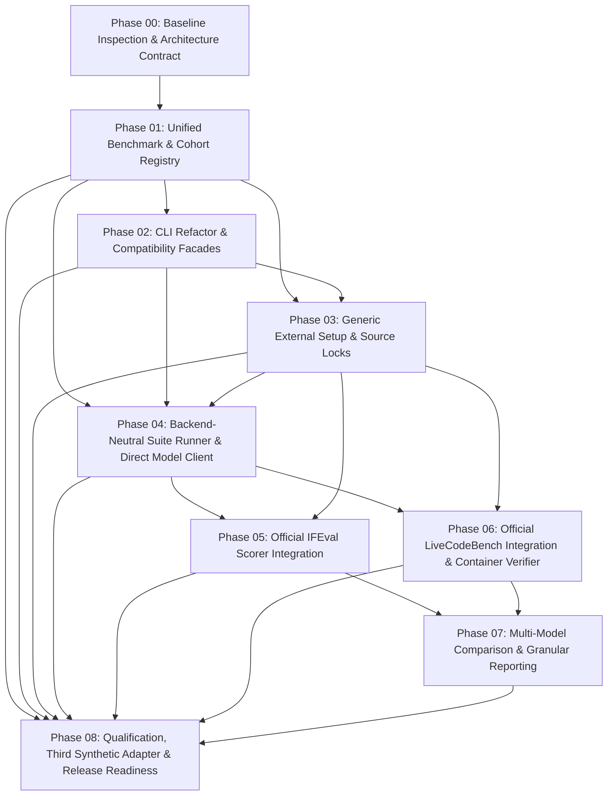

# Extensible Benchmark Platform Integration Plan

## Executive Summary
This plan implements the multi-phase architecture defined in `MASTER_PLAN.md` (and phases 00–08) for `MaxCarlson/scripts` in `modules/agent_benchmark` and `modules/benchmark_core`.

The implementation creates a unified, extensible benchmark catalog, refactors the CLI, builds a generic external-source installer storing assets outside Git tracking, implements a backend-neutral suite executor, integrates official Google IFEval and LiveCodeBench evaluation, adds multi-model comparison reports, and qualifies the platform with an extensible third synthetic benchmark.

## Phase Overview & Dependency Sequence

## Phase Descriptions

### Phase 00 — Baseline, Boundaries, and Contracts
- Baseline tests, git status, worktree isolation, baseline outputs.
- Architectural contract and CLI compatibility matrix.

### Phase 01 — Unified Benchmark, Dataset, and Cohort Registry
- Authoritative catalog replacing duplicate sources of truth.
- Unified schema (`BenchmarkDescriptor`, `DatasetDescriptor`, `CohortDescriptor`).
- Backward-compatible facades for `harbor.datasets` and `suite.COHORTS`.
- Resolves Terminal-Bench omission in `suite list`.

### Phase 02 — CLI Refactor and Backward Compatibility
- Modularize 1,200-line `cli.py` into `cli_commands/` submodules.
- Preserve all root commands (`plan`, `run`, `status`, `cleanup`, `smoke`).
- Introduce `setup` command group with `-A/--all`.
- Preserve `suite plan -A` as `--api-format`.
- Preserve `agent-bench`, `agent-benchmark`, and `agent_benchmark` entrypoints.

### Phase 03 — Generic External Benchmark Setup and Source Locks
- Reusable `SourceManager` for external Git checkouts, sparse checkouts, HF datasets, and isolated Python venvs.
- External storage outside git-tracked tree (`%LOCALAPPDATA%\agent-benchmark` / `~/.local/share/agent-benchmark`).
- Atomic staging, integrity verification (SHA-256), and lock receipts.
- Implement `setup -A`, `setup plan -A`, `setup install -A`, `setup install -A -x`, `setup status -A`, `setup verify -A`.

### Phase 04 — Backend-Neutral Persistent Suite Runner and Direct Model Client
- Decouple `suite.py` lifecycle from Harbor runner.
- Backend protocol (`ExecutionBackend`, `ScoringAdapter`, `ResultNormalizer`).
- Local direct-model OpenAI-compatible chat client using `httpx`.
- Retain checkpointing, lock/claim, resume, and LLM monitor evidence.

### Phase 05 — Official IFEval Integration
- Pin official Google Research IFEval reference scorer.
- Pinned dataset snapshot (541 prompts), deterministic `ifeval-smoke`, `ifeval-100`, and `ifeval-full` cohorts.
- Official strict and loose prompt-level and instruction-level scoring.

### Phase 06 — Official LiveCodeBench Direct Code Generation & Sandboxed Scoring
- Pin official `LiveCodeBench` `release_v6` code-generation-lite.
- Deterministic cohorts `lcb-v6-smoke`, `lcb-v6-direct-100`, `lcb-v6-direct-full`.
- Official upstream evaluation bridge.
- Isolated container verifier (no network, non-root, read-only rootfs, resource bounds).

### Phase 07 — Multi-Model Comparison, Score Granularity, and Reports
- Strict within-benchmark paired comparisons with `declared-model-intervention-v1`.
- Coverage metrics (planned, attempted, scored, invalid).
- Paired statistics and Wilson confidence intervals.
- `suite compare` CLI command.

### Phase 08 — Integration Qualification, Third-Adapter Proof, and Documentation
- Golden CLI compatibility verification.
- Third synthetic benchmark adapter proving extensibility without framework edits.
- Security and sandbox enforcement qualification.
- Final documentation and integration handoff.
