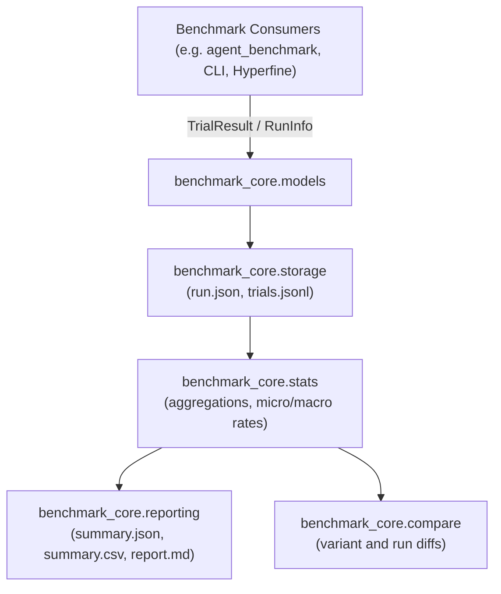

# Benchmark Core Documentation

`benchmark_core` is a lightweight benchmarking data, normalization, aggregation, and reporting package.

## Architecture

## Public Contracts

- `RunInfo`: Represents a benchmark batch and configuration (with variant matrix, reproducibility metadata, scoring basis).
- `TrialResult`: Represents a single execution attempt of a task/variant repetition.
- `MetricValue`: Represents a numerical measurement with source, unit, and provenance quality.

## Documentation Index

- [HANDOFF.md](HANDOFF.md): Current operational status, branch, and immediate next steps.
- [plans/HANDOFF.md](plans/HANDOFF.md): Index of active and completed implementation plans.
