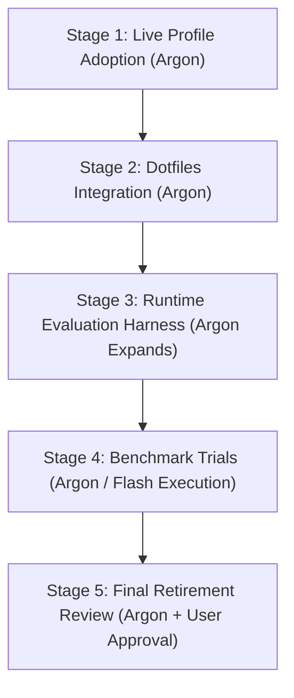

# Host Adoption, Dotfiles Wiring, and Runtime Evaluation Plan

## Executive Summary

This independent plan is authored specifically for **Argon** (or a flagship high-reasoning model) to execute post-Stage-1 completion of `local_agent_bridge` 2.0.0 (commit `a617d29e`).

While Flash (High) successfully implemented and validated the independent installer, CLI hierarchy, and packaged assets against isolated test roots, transitioning to host-level adoption, dotfiles wiring, and live multi-agent runtime validation requires complex semantic analysis, cross-repository dependency management, and multi-agent protocol verification.

This document clearly partitions:
1. **What Argon must expand**: Deep analysis, architectural design, divergence audits, and test harness specifications.
2. **What Argon must implement**: High-stakes executions, live profile adoptions, hook integrations, and behavioral evaluations.
3. **What can be delegated down to Flash (High)**: Lower-risk, well-bounded execution steps once Argon has fully expanded their plans.

---

## Work Breakdown by Area

### Area 1: Host Profile Adoption & Instruction Reconciliation

#### What Argon Must Expand
- **Live State Inspection & Semantic Diff Audit**:
  - Deep-dive into active host files: `~/.codex/AGENTS.md` (active file symlink into dotfiles), `~/.codex/config.toml`, `~/.gemini/GEMINI.md` (regular file with active user edits), and `~/.gemini/settings.json`.
  - Perform a semantic comparison between live instructions and the packaged templates in `local_agent_bridge/resources/dotfiles_llms/` and `resources/profiles/AGENTS.md`.
  - Reconcile instruction divergence: Ensure that any active user rules or personalizations in `~/.gemini/GEMINI.md` become the baseline and are NOT silently overwritten or dropped.
- **Adoption Plan Validation**:
  - Formulate the exact adoption IDs (`codex.instructions`, `agy.instructions`, `codex.custom-skill.test-verify`).
  - Generate and inspect the read-only migration plan (`local_agent setup plan -o migration-plan.json`).
  - Verify operation fingerprints and preflight checks in the JSON plan.
  - Review backup and recovery mechanisms in `~/.local/share/local-agent/`.

#### What Argon Must Implement
- Execute the verified adoption: `local_agent setup apply -i migration-plan.json`.
- Verify post-install state: `local_agent setup status -j` confirming 0 conflicts and 0 drift.
- Exercise rollback verification (`local_agent setup remove` in preview mode) to ensure the recovery journal accurately tracks pre-adoption state.

#### What Can Be Handed to Flash
- Running automated test suites (`pytest modules/local_agent_bridge/tests`).
- Running periodic drift check commands (`local_agent setup status`) once Argon completes adoption.

---

### Area 2: Dotfiles Integration & Multi-Client Safety

#### What Argon Must Expand
- **Dotfiles LLM Infrastructure Audit**:
  - Inspect `dotfiles/symlinks.sh` and corresponding PowerShell installer scripts in the user's `dotfiles` repository.
  - Map every symlink currently originating from `dotfiles/symlinked/llms/` across all editors (Codex, Antigravity, Claude, Cursor).
- **Non-Migrated Client Isolation Architecture**:
  - Design a transition strategy ensuring Claude and Cursor continue functioning without broken symlinks, even as Codex and Antigravity transition to `local_agent`.
  - Specify the exact retirement conditions for the old `dotfiles/symlinked/llms` directory (ensuring zero premature file deletions).
- **Dotfiles Hook Integration Design**:
  - Design the insertion of `integrations/setup-agents.ps1` and `setup-agents.sh` into dotfiles setup.
  - Account for environment edge cases (e.g. `src/scripts` repository path resolution, missing virtualenv fallback, `-WhatIf` / dry-run support).

#### What Argon Must Implement
- Wire the replacement hooks into the dotfiles installation scripts.
- Validate dotfiles bootstrap dry-runs on both PowerShell and Bash.

#### What Can Be Handed to Flash
- Shell script syntax linting and formatting.
- File hash verifications against `migration.json`.

---

### Area 3: Coordinator-Worker Runtime Hand-off & Behavioral Evaluation

#### What Argon Must Expand
- **Disposable Benchmark Framework Design**:
  - Design an isolated evaluation fixture (disposable git repository) with controlled code files and known test tasks.
- **Evaluation Scenarios & Protocol Bounds**:
  - **Scenario A (Reviewer Boundary Enforcement)**: Formulate a task prompt for `local-reviewer`. Define assertions proving that tool permissions block file edits and shell command execution.
  - **Scenario B (Worker Scope & Honest Evidence)**: Formulate a task prompt for `local-worker`. Define assertions checking that edits stay within targeted files, diffs are clean, honest evidence is recorded, and the worker does NOT attempt recursive handoffs.
  - **Scenario C (Async Protocol & Failure Handling)**: Design tests for OpenCode MCP tools (`opencode_fire`, `opencode_wait`, `opencode_status`, `opencode_reply`). Specify recovery behaviors for delayed jobs, user input prompts, timeout handling, and preventing duplicate task submissions.
  - **Scenario D (Structured Output vs Fallback)**: Validate `result.schema.json` conformance and plain text graceful degradation.
- **Metrics Specification**:
  - Metrics to measure: coordinator context tokens saved vs used, end-to-end task duration, retry counts, and qualitative code accuracy.

#### What Argon Must Implement
- Stand up the disposable evaluation workspace.
- Start the bridge (`local_agent run -M <model> -N` or live server) and execute the live scenarios via Codex and Antigravity.
- Analyze worker output, review traces, and document findings in `modules/local_agent_bridge/docs/BENCHMARK.md`.

#### What Can Be Handed to Flash
- Running repeated benchmark iterations once Argon has finalized the prompts and harness (e.g. executing 5 test runs to collect latency/token averages).
- Collecting log outputs and compiling markdown tables.

---

## Phased Execution Roadmap for Argon

1. **Stage 1: Live Profile Adoption**:
   - Inspect active `~/.codex` and `~/.gemini` files.
   - Reconcile instruction diffs.
   - Run adoption plan & verify 0 drift.
2. **Stage 2: Dotfiles Wiring**:
   - Integrate `setup-agents.ps1` and `.sh` into dotfiles.
   - Preserve Claude/Cursor paths.
3. **Stage 3: Runtime Test Harness Creation**:
   - Stand up disposable project.
   - Write evaluation test fixtures and prompts.
4. **Stage 4: Live Model Delegation Benchmark**:
   - Run review task, edit task, async edge cases, and schema validation.
   - Document quantitative metrics in `docs/BENCHMARK.md`.
5. **Stage 5: Legacy Decommissioning Review**:
   - Check all symlinks; prepare final retirement of `dotfiles/symlinked/llms`.
