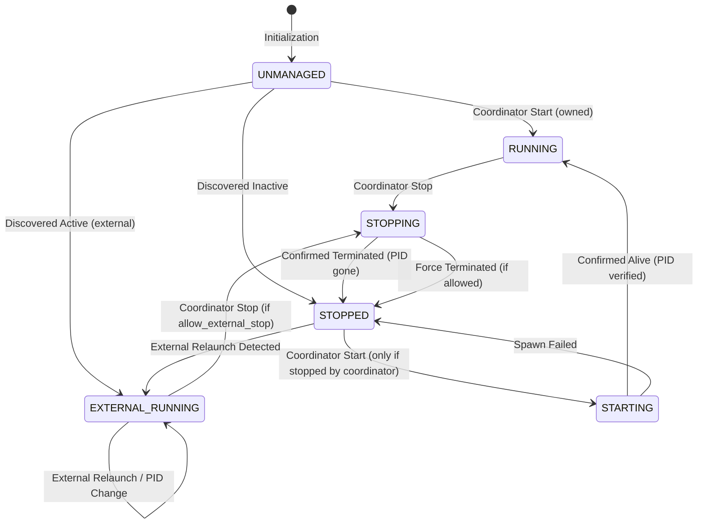

# Cross-Resource Serialization & State Machine Design

**Module:** `modules/resource_coordinator`  
**Document version:** 1.0  
**Status:** Architecture Specification for Phase C Integration  
**Target Platform:** Windows 11 / RTX 5090 / LM Studio 0.3.x / Krig Miner 1.5.6  

---

## 1. Executive Summary

The Resource Coordinator arbitrates access to physical compute resources (specifically an NVIDIA RTX 5090) shared between long-running background workloads (Krig cryptocurrency miner) and high-priority, latency-sensitive interactive workloads (LM Studio LLM inference and model lifecycle management).

Because multiple asynchronous actors (HTTP clients, streaming SSE connections, idle timers, external process supervisors, and administrative recovery tools) interact concurrently, uncoordinated interleavings can result in serious failure modes:
1. **GPU Collision / OOM Crash:** A background miner restarting or failing to stop while LM Studio initiates tensor allocation.
2. **Inverted Scheduling / Process Leak:** An idle restart action completing *after* a new inference stop action, leaving the miner active during model inference.
3. **Premature Resumption:** An active stream disconnecting abruptly, causing the coordinator to assume completion and restart mining while LM Studio is still executing tokens in the background.
4. **Deadlock / Starvation:** Model loading acquiring exclusive locks while active inferences hold shared locks, blocking cleanup.

This document specifies the formal lock hierarchies, synchronization invariants, state machines, and arbitration semantics required to guarantee safety across all resource and process boundaries.

---

## 2. Resource Hierarchy and Lock Ordering

To prevent deadlocks and ensure deterministic behavior across concurrent asynchronous tasks, all locks and resource claims must be acquired strictly in the following hierarchical order:

```
┌─────────────────────────────────────────────────────────────┐
│ Level 1: Global Resource Arbitration Lock (LeaseManager)    │
│          guards: _active, _pending, _inhibitions, cooldowns │
└──────────────────────────────┬──────────────────────────────┘
                               │
                               ▼
┌─────────────────────────────────────────────────────────────┐
│ Level 2: Resource Leases (Logical Claims)                   │
│          gpu.model (Exclusive)                              │
│             │                                               │
│             ▼                                               │
│          gpu.inference (Shared)                             │
└──────────────────────────────┬──────────────────────────────┘
                               │
                               ▼
┌─────────────────────────────────────────────────────────────┐
│ Level 3: Process Execution Serialization (ProcessSupervisor)│
│          guards: per-process start / stop / status state    │
└─────────────────────────────────────────────────────────────┘
```

### 2.1 Formal Lock Invariants

1. **Strict Monotonic Ordering:** Code holding a Level 3 lock (e.g., `ProcessSupervisor._lock`) must **NEVER** await or acquire a Level 1 or Level 2 lock.
2. **Two-Stage Atomic Lease Reservation:**
   - Every inference or model request entering the gateway **must** create a `LeaseReservation` before invoking any Level 3 action (such as `StopProcessAction`).
   - Entering `reserve()` synchronously:
     - Cancels any running idle cooldown timer for that resource.
     - Increments `pending_count(resource)`.
     - Emits `resource.lease_requested`.
   - Blocking policy hooks (such as miner shutdown) execute *after* the reservation is recorded.
   - If an incoming request is rejected, cancelled, or aborted during the pre-action phase, the reservation's `close()` context manager guarantees that `pending_count` is decremented and idle cooldown is evaluated cleanly without leaking pending claims.
3. **Exclusive Model Precedence:**
   - A lease for `gpu.model` requires `LeaseType.EXCLUSIVE`.
   - While `gpu.model` is held or pending activation:
     - No new `gpu.inference` leases can be granted.
     - New inference requests queue until `gpu.model` is released.
   - Once all active `gpu.inference` leases are released, `gpu.model` is promoted.

---

## 3. Process State Machine and Supervision Mutex

A process supervisor manages an external or child operating system process. To prevent racing `start()` and `stop()` commands from interleaving, each `ProcessSupervisor` maintains an asynchronous serialization lock (`_action_lock`).

### 3.1 State Diagram



### 3.2 Race Prevention: Start vs. Stop Interleaving

Consider the following interleaving without per-process serialization:
- **T0:** Inference finishes on `gpu.inference`. Cooldown expires. Idle handler dispatches `StartProcessAction("krig")`.
- **T1:** `StartProcessAction` enters `await supervisor.start()`. It begins preparing the Windows command line and environment.
- **T2:** A new user request hits `POST /v1/chat/completions`.
- **T3:** Gateway emits `resource.lease_requested`. Policy dispatches `StopProcessAction("krig")`.
- **T4:** `StopProcessAction` checks status: process is not yet running (still in `STARTING` phase). It considers its job done or fails.
- **T5:** `StartProcessAction` finishes spawning `krig-miner.exe`.
- **Result:** Miner is now running concurrently with user inference!

#### Architectural Solution:
1. **Process Action Mutex (`supervisor._action_lock`):**
   - Both `start()` and `stop()` acquire `async with self._action_lock:`.
2. **Pre-Start Dependency Verification:**
   - Inside `start()`, before calling OS spawn APIs, the supervisor queries the `LeaseManager`:
     ```python
     if self.lease_mgr.active_count("gpu.inference") > 0 or self.lease_mgr.pending_count("gpu.inference") > 0:
         logger.warning("Aborting start of '%s': resource has active or pending leases", self.name)
         return False
     if self.lease_mgr.is_restart_inhibited("gpu.inference"):
         logger.warning("Aborting start of '%s': restart is inhibited", self.name)
         return False
     ```
3. **Post-Stop State Latching:**
   - `was_stopped_by_coordinator` is set to `True` if and only if the coordinator confirmed the transition from `RUNNING` or `EXTERNAL_RUNNING` to `STOPPED`.
   - If the process was already `STOPPED` before the stop action ran, `was_stopped_by_coordinator` remains `False`.
   - `StartProcessAction(only_if_stopped_by_coordinator=True)` strictly refuses to start any process where `was_stopped_by_coordinator` is `False`.

---

## 4. Inference Termination Uncertainty & Inhibition State Machine

When communicating with upstream HTTP inference engines (LM Studio, vLLM, Ollama), client network disconnects, HTTP timeouts, and SSE stream drops do **not** imply that the engine has stopped generating tokens.

### 4.1 Termination State Classification

Every inference request completes in exactly one of three states:

| Termination State | Evidence Required | Action Taken |
| :--- | :--- | :--- |
| **Confirmed Success** | Upstream HTTP 200 with complete JSON body and `finish_reason`, OR complete SSE stream terminating with explicit `data: [DONE]` / `event: done`. | Release lease cleanly. Decrement active count. If 0 active and 0 pending, start idle cooldown. |
| **Confirmed Failure / Veto** | Gateway rejected request (e.g. 503 VetoOperation, 400 Invalid Model) before forwarding, OR upstream returned immediate non-200 HTTP error without partial streaming. | Release lease cleanly. |
| **Indeterminate / Uncertain** | Client disconnected mid-stream (`RemoteProtocolError`, `CancelledError`), upstream dropped connection before `[DONE]`, or upstream timed out mid-generation. | **Impose Restart Inhibition.** Prevent all background process restarts until explicitly resolved. |

### 4.2 Protective Restart Inhibition

When an uncertain termination occurs:
1. The gateway executes `await lease_mgr.inhibit_restart(resource="gpu.inference", reason="indeterminate_cancellation", holder_id=request_id)`.
2. This immediately cancels any running cooldown timer.
3. The inhibition record contains:
   - `resource`: Target resource name.
   - `reason`: Classification of uncertainty (e.g. `client_disconnect_during_stream`, `upstream_socket_drop`).
   - `holder_id`: Unique request correlation ID.
   - `inhibited_at`: UNIX epoch timestamp.
   - `details`: Upstream endpoint, model ID, elapsed stream duration, and token count prior to failure.
4. **Non-Clearing Invariant:** Subsequent successful inference requests completing normally **must never** clear or override a prior restart inhibition. The inhibition remains locked in place.
5. **Administrative Recovery Invariant:** The administrative recovery command (`resource-coordinator recover`) can only clear the inhibition if `active_count == 0` and `pending_count == 0`. It cannot force a restart if active workloads are present.

---

## 5. Summary of Synchronization Guarantees

| Invariant | Mechanism | Verification Test |
| :--- | :--- | :--- |
| **Atomic Claim Precedence** | Two-stage `reserve()` increments pending and cancels cooldown before any async sleep or external call. | `test_atomic_registration_cancels_cooldown_before_hooks` |
| **Out-of-Order Safety** | Reference-counted active list in `LeaseManager` keyed by unique `Lease` identity. | `test_resource_claims_released_in_different_orders` |
| **No Premature Restart** | `is_cooling_down` evaluates to `False` while any lease is active or pending; cooldown resets on every new arrival. | `test_multiple_inferences_arrive_during_miner_shutdown` |
| **External Supervisor Defense** | Verified status checks post-stop detect unexpected PIDs or immediate relaunch. | `test_external_supervisor_immediate_relaunch` |
| **Inhibition Durability** | Unresolved uncertainty latches `_inhibitions[resource]`; later successful requests do not wipe the latch. | `test_later_successful_request_does_not_clear_prior_inhibition` |
