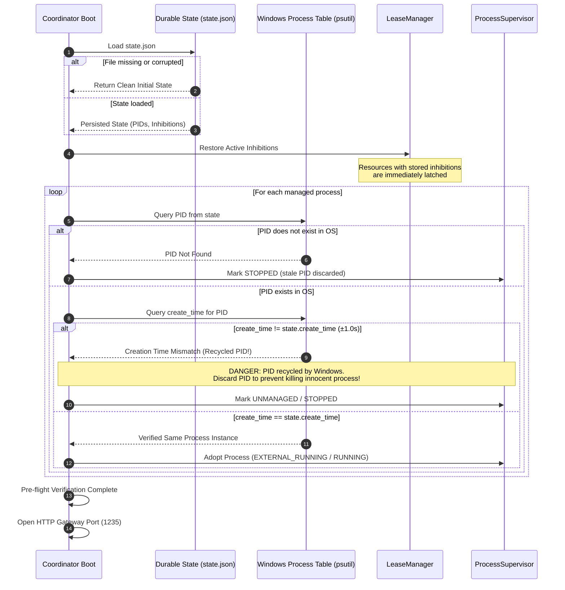

# Durable State, Crash Recovery, and PID Reconciliation Design

**Module:** `modules/resource_coordinator`  
**Document version:** 1.0  
**Status:** Architecture Specification for Phase C Integration  
**Target Platform:** Windows 11 / RTX 5090 / Krig Miner 1.5.6  

---

## 1. Objective and Problem Statement

When the Resource Coordinator process terminates—whether due to planned restarts, host reboot, software upgrades, or unexpected crashes—the physical state of the host may not match an in-memory clean slate:
1. **Uncertain Inference in Progress:** An inference stream may have been severed when the coordinator died, leaving LM Studio actively generating tokens on the RTX 5090.
2. **Orphaned Miner Processes:** The miner (`krig-miner.exe`) may still be running in an external console or child process group with an assigned PID.
3. **PID Recycling Hazard:** On Windows, 32-bit Process IDs are recycled aggressively. After a reboot or process termination, an old PID may now belong to an unrelated critical Windows process (e.g., `svchost.exe`, `csrss.exe`, or `explorer.exe`). Sending termination signals based solely on a persisted PID could terminate arbitrary user or system processes.
4. **Protective Inhibition Loss:** If restart inhibitions are kept only in memory, restarting the coordinator resets all inhibitions to empty. If no inference requests are immediately active, the coordinator would evaluate the resource as idle and restart the miner, causing a collision with an unmanaged background workload.

This document specifies the design for atomic durable state persistence, PID reconciliation against the Windows process table, and crash recovery procedures.

---

## 2. Durable State Schema

Durable state is stored in an atomic, versioned JSON file (e.g., `%LOCALAPPDATA%\resource_coordinator\state.json` or a custom configured path):

```json
{
  "version": "1.0",
  "updated_at": 1729350000.123,
  "inhibitions": {
    "gpu.inference": {
      "resource": "gpu.inference",
      "reason": "indeterminate_cancellation",
      "holder_id": "req-98234",
      "inhibited_at": 1729349950.000,
      "details": {
        "model": "qwen2.5-coder-32b",
        "error": "Client disconnected before [DONE]"
      }
    }
  },
  "processes": {
    "krig_miner": {
      "name": "krig_miner",
      "pid": 48204,
      "create_time": 1729348800.450,
      "lifecycle_owner": "coordinator",
      "was_stopped_by_coordinator": true,
      "last_stopped_at": 1729349900.000,
      "last_started_at": 1729348800.000
    }
  }
}
```

### 2.1 State Components

1. **`inhibitions`:** Active restart inhibitions mapped by resource name (`gpu.inference`, `gpu.model`).
   - If an inhibition exists in the durable state, it **must** be loaded into `LeaseManager._inhibitions` on startup.
   - The coordinator **cannot** start the miner on boot if an inhibition is present.
   - It requires explicit user recovery (`resource-coordinator recover`) or a verified clean health probe.
2. **`processes`:** Tracked state for each configured process.
   - `pid`: Process identifier at the time of record.
   - `create_time`: Windows high-resolution process creation timestamp (`psutil.Process.create_time()`).
   - `was_stopped_by_coordinator`: Preserves ownership across restarts. If the coordinator paused the miner before a crash or restart, this flag ensures it knows the miner is eligible for resumption once safety is verified.

---

## 3. Atomic Write Architecture

To prevent corruption from partial writes during sudden power loss or process termination:

1. **Atomic File Replacement:**
   - The serialized JSON state is written to a temporary sibling file: `state.json.tmp.<uuid>`.
   - The file is flushed and synced to disk via `flush()` and `os.fsync()`.
   - An atomic filesystem rename (`os.replace`) overwrites `state.json`. On NTFS (Windows 11), `os.replace` is an atomic directory operation.
2. **Write Trigger Policy:**
   - State is persisted on state transition boundaries:
     - `resource.restart_inhibited`
     - `resource.restart_inhibition_cleared`
     - Process state transitions (`STOPPED`, `RUNNING`, `was_stopped_by_coordinator` change)
   - Writes are debounced or dispatched to a background worker to ensure synchronous fast-path inference is not blocked on disk I/O.

---

## 4. Startup Reconciliation Protocol

Upon startup, the coordinator executes the following reconciliation sequence before opening the gateway port (1235) or starting any services:



### 4.1 PID Recycling Defense Algorithm

```python
def reconcile_process_pid(persisted_pid: int, persisted_create_time: float) -> ProcessReconciliationResult:
    if not psutil.pid_exists(persisted_pid):
        return ProcessReconciliationResult.NOT_RUNNING

    try:
        proc = psutil.Process(persisted_pid)
        current_create_time = proc.create_time()
        # Windows timestamp precision tolerance: 1.0 second
        if abs(current_create_time - persisted_create_time) > 1.0:
            logger.warning(
                "PID %d exists but create_time %.3f != persisted %.3f. PID was recycled! Ignoring.",
                persisted_pid, current_create_time, persisted_create_time
            )
            return ProcessReconciliationResult.PID_RECYCLED
        return ProcessReconciliationResult.VERIFIED_RUNNING
    except (psutil.NoSuchProcess, psutil.AccessDenied):
        return ProcessReconciliationResult.NOT_RUNNING
```

---

## 5. Administrative Recovery Interface

If a crash or indeterminate cancellation leaves a persistent restart inhibition, the administrator or developer uses the CLI to safely inspect and recover the system:

1. **Inspect State:**
   ```powershell
   resource-coordinator status
   ```
   Outputs:
   - Resource status (`gpu.inference`, active leases: 0, pending: 0, cooldown: inactive).
   - Inhibition details: `Inhibited since 2026-10-19 12:00:00 (indeterminate_cancellation: client disconnect)`.
   - Process status: `krig_miner` (State: STOPPED, was_stopped_by_coordinator: True).

2. **Verify Host GPU State:**
   ```powershell
   resource-coordinator diagnose
   ```
   Verifies via `nvidia-smi` that GPU memory and utilization are idle and LM Studio is not running a forgotten compute graph.

3. **Execute Recovery:**
   ```powershell
   resource-coordinator recover --resource gpu.inference
   ```
   - Checks that active leases = 0 and pending leases = 0.
   - Clears `gpu.inference` inhibition in memory and on disk.
   - Triggers standard idle cooldown (60s) before resuming any background miner.
